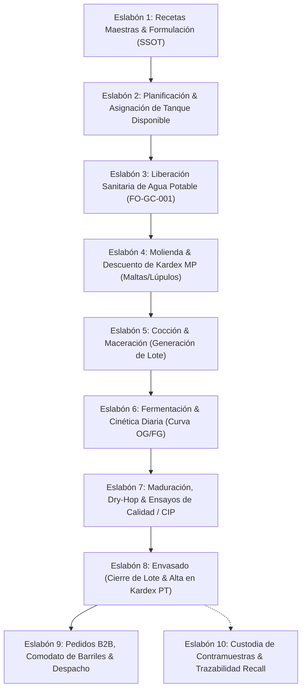
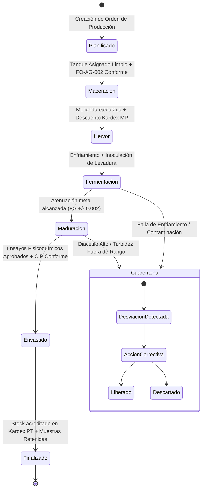
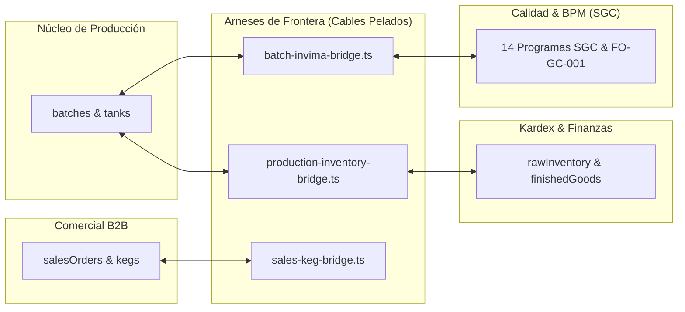

# 🛡️ Cervecería NORTA OS — Contrato Canónico de Arquitectura (SPEC.md)
# Versión: 1.2.0 (Enmienda RFC Blindaje Anti-Veto: Zero-Any, Cero Silent-Catches & Tolerancia Cuantitativa)
# Estado: ACTIVO Y VIGENTE (SSOT Innegociable)
# Fecha de Emisión: 2026-10-16
# Autoridad: Arquitecto SDD & Lead Cloud Engineer

---

## 0. Leyes Marciales de Arquitectura & Estrategia de Desarrollo

Toda línea de código, componente, hook o función que se agregue o modifique en este repositorio debe someterse a estas leyes marciales:

1. **El Código es un Subproducto del Contrato:** Ningún controlador, componente visual o mutación de datos puede crearse o modificarse si no está previamente estipulado en este `SPEC.md` o en los contratos tipados de frontera.
2. **Prohibición Absoluta de Monolitos (`Thin UI < 600 líneas`):** Queda terminantemente prohibido crear o extender archivos `.tsx` o `.js` que superen las 600 líneas. Los motores matemáticos (cinética cervecera, dilución, mermas, costeo COP) y las transacciones de base de datos pertenecen exclusivamente al **Headless Core** (`src/lib/engines/` o `src/services/`).
3. **Cero Emojis y Cero Glifos Unicode en UI:** Toda señalización visual, botón, badge o status bar debe utilizar componentes vectoriales de **`lucide-react`**. Queda prohibido el uso de emojis (`🍺`, `⚠️`, `✅`, `📦`, `🧪`, etc.).
4. **Núcleos Intocables con Bloqueo de Solo Lectura (`READ-ONLY LOCK`):**
   - **`[LOCK-01]` Fórmulas Matemáticas de Cinética y Amargor:** Algoritmos de cálculo de ABV, atenuación aparente, densidad específica (OG/FG) e IBU (Tinseth).
   - **`[LOCK-02]` Validación Sanitaria de Agua Potable (Decreto 2115 de 2007):** Regla de umbral inmutable de Cloro Residual ($0.3 - 2.0\text{ mg/L}$) y pH ($6.5 - 9.0$).
   - **`[LOCK-03]` Esquema Maestro de Recetas de Autor:** Las 6 formulaciones originales de NORTA son inmutables en estructura.
5. **Estrategia de "Cables Pelados" (*Clean Boundary Harness*):** La interconexión entre dominios (Producción $\leftrightarrow$ Kardex $\leftrightarrow$ INVIMA $\leftrightarrow$ CRM) se realiza exclusivamente a través de arneses puente externos (`*-bridge.ts`), sin acoplar los componentes visuales ni alterar los núcleos intocables.
6. **Máquinas de Estado Explícitas (FSM):** Cero transiciones en memoria volátil (`useState` huérfanos). Todo cambio de etapa en la producción o pedido debe persistirse atómicamente en Cloud Firestore con marca de tiempo del servidor (`serverTimestamp`).
7. **Prohibición de Capturas Ciegas, Evasiones y Casts Forzados (`Zero-Any & No-Silent-Catches`):** Queda terminantemente prohibido el uso de bloques `catch` vacíos (`catch (_) {}`), supresiones del compilador (`@ts-ignore`, `eslint-disable`) o casts a `any` (`(b as any)`). Todo error en servicios de almacenamiento, I/O o red debe ser registrado con logging estructurado de telemetría (`console.warn('[STORAGE_FALLBACK]', err)`).

---

## 1. Misión del Sistema & Cadena Causal del Pipeline

### 1.1. Propósito Central
Gobernar de forma integral y a prueba de fallos la manufactura cervecera artesanal, la gestión de inventarios con costeo en pesos colombianos (COP), el parque comercial de barriles y el cumplimiento estricto de las Buenas Prácticas de Manufactura (BPM) bajo la normativa sanitaria del INVIMA (Resolución 2674 de 2013 y Decreto 2115 de 2007) mediante el Sistema de Gestión de Calidad (SGC) estandarizado en 14 programas oficiales (Carpetas `00` a `13`, Emisión Octubre 2026).

### 1.2. Cadena Causal del Pipeline Operativo (Eslabones Dependientes)
La información fluye de manera estrictamente determinista: el resultado del Eslabón $N$ es la precondición obligatoria del Eslabón $N+1$.



* **Invariante Causal 1:** No se puede iniciar la maceración de un lote sin que el registro diario de agua potable (`FO-GC-001`, antes `FO-AG-002`) certifique cumplimiento de cloro ($0.3-2.0\text{ mg/L}$) y pH ($6.5-9.0$) (Poka-Yoke Sanitario bajo Decreto 2115 de 2007).
* **Invariante Causal 2:** No se puede pasar un lote a etapa *Envasado* sin que el tanque cuente con registro CIP previo conforme (`FO-GC-003` / `cipLogs`) y ensayos de calidad aprobados (`FO-GC-035` / `qualityTests`).
* **Invariante Causal 3:** Toda salida de almacén de materias primas debe vincularse de forma bidireccional al ID del lote (`batchCode`) y a su registro de recepción (`FO-GC-011` / `FO-GC-015`).

---

## 2. Restricciones Técnicas & Modularidad (Headless Core + Thin UI)

### 2.1. Pila Tecnológica & Entorno de Ejecución
* **Framework:** Next.js 14+ (App Router).
* **Lenguaje:** TypeScript estricto (modo `strict: true`).
* **Estilos:** Tailwind CSS con paleta institucional Craft Luxury (Deep Navy `#0e2334`, Aged Gold `#c9b38f`, Parchment `#f7f4ed`).
* **Iconografía:** `lucide-react` exclusivo (cero emojis).
* **Base de Datos:** Google Cloud Firestore con persistencia offline `IndexedDB` multiventana (`enableMultiTabIndexedDbPersistence`).
* **Almacenamiento Binario:** Google Cloud Storage (`gs://cerveceria-norta.firebasestorage.app`).
* **Puerto de Desarrollo Local:** `3000` (`npm run dev -- -p 3000`).

### 2.2. Regla Anti-Monolito y Descomposición Arquitectónica
El monolito heredado de 4.824 líneas ([`src/components/NextBreweryApp.js`](file:///g:/Mi%20unidad/Proyectos%20Antigravity%202026/cerveceria-norta/src/components/NextBreweryApp.js)) queda clasificado en **Estado de Cuarentena y Desmantelamiento Progresivo**. 

La arquitectura se divide rígidamente en:
1. **Headless Engines (`src/lib/engines/*.ts`):**
   - `brewingKineticsEngine.ts`: Funciones puras para cálculo de atenuación, alcohol por volumen (ABV), densidad corregida por temperatura y color SRM.
   - `sanitaryPokaYokeEngine.ts`: Evaluador de umbrales normativos para los 14 programas INVIMA / SGC.
   - `inventoryValuationEngine.ts`: Métodos de costeo en COP, valuación de merma y Kardex ponderado.
   - `recallGraphEngine.ts`: Algoritmo de grafo inverso para reconstrucción de trazabilidad en $< 2\text{ horas}$.
2. **Thin UI Components (`src/components/` & `app/`):**
   - Máximo **600 líneas por archivo**.
   - Responsabilidad única: suscripción al hook de datos, pintado reactivo y emisión de eventos hacia los motores.

---

## 3. Modelo de Dominio, Diccionario de IDs Canónicos & Máquinas de Estado

### 3.1. Diccionario Canónico de Identidad (Prevención de Babel de IDs)

Queda estrictamente prohibido usar alias ambiguos. Todos los módulos y arneses de empalme deben respetar este identificador:

| Entidad | ID Canónico Único | Formato / Regex | Ejemplo Válido | Colección Firestore |
| :--- | :--- | :--- | :--- | :--- |
| **Receta** | `recipeId` | `^rec-[a-z0-9-]+$` | `rec-cumbre-golden` | `/recipes/{recipeId}` |
| **Lote de Producción** | `batchCode` | `^NOR-[0-9]{4}-[A-Z0-9]+$` | `NOR-2601-IPA` | `/batches/{batchCode}` |
| **Tanque / Fermentador**| `tankId` | `^TK-[0-9]{2}$` | `TK-01` | `/tanks/{tankId}` |
| **Insumo (Materia Prima)**| `rawItemId` | `^RAW-[A-Z]{3}-[0-9]{3}$` | `RAW-MAL-001` | `/rawInventory/{rawItemId}` |
| **Producto Terminado** | `finishedGoodId` | `^FG-[A-Z]{3}-[A-Z0-9]+$`| `FG-CUM-B330` | `/finishedGoods/{finishedGoodId}` |
| **Cliente B2B** | `clientId` | `^CLI-[0-9]{3}$` | `CLI-001` | `/clients/{clientId}` |
| **Pedido Comercial** | `orderId` | `^ORD-[0-9]{4}-[0-9]{3}$` | `ORD-2026-045` | `/salesOrders/{orderId}` |
| **Barril de Acero** | `kegSerial` | `^NOR-K(20\|30\|50)-[0-9]{3}$` | `NOR-K50-014` | `/kegs/{kegSerial}` |
| **Programa SGC (14)** | `programId` | `^prog-[0-9]{2}-[a-z-]+$` | `prog-00-manual` | `/invimaPrograms/{programId}` |
| **Documento Oficial SGC**| `docCode` | `^(MN\|PT\|PG\|PR\|IN\|FO\|FT\|PL)-GC-[0-9]{3}(-[A-Z0-9]+)?$` | `FO-GC-001` | `/documentRepository/{docCode}` |
| **Log Sanitario Agua** | `waterLogId` | `^WLOG-[0-9]{3,}$` | `WLOG-412` | `/invimaWaterLogs/{waterLogId}` |
| **Log Almacenamiento** | `storageLogId` | `^SLOG-[0-9]{3,}$` | `SLOG-001` | `/invimaStorageLogs/{storageLogId}` |
| **Log Temperatura Frío**| `coldRoomLogId`| `^CF-[0-9]{3,}$` | `CF-001` | `/coldRoomLogs/{coldRoomLogId}` |
| **Log Recepción MP** | `receiptLogId` | `^REC-[0-9]{3,}$` | `REC-001` | `/rawMaterialReceiptLogs/{receiptLogId}` |

* **Regla de Homologación Estricta de Lotes (`Batch`):** El identificador único canónico obligatorio en memoria, bases de datos Firestore y arneses de empalme (`*-bridge.ts`) es exclusivamente `batchCode: string`. La propiedad `id` existe únicamente como alias de solo lectura retrocompatible (`id === batchCode`). Queda terminantemente vetado el uso de `(b as any).batchCode` o la degradación a cadenas de fallback ambiguas (`"LOTE-SIN-ID"`). Si un lote carece de `batchCode`, el puente debe arrojar inmediatamente una violación contractual (`ERR_INVALID_BATCH_CODE`).


### 3.2. Máquina de Estados Finita (FSM) de Producción de Lotes

Las transiciones de etapa de un lote no pueden ocurrir en memoria React. Cada transición ejecuta una escritura atómica en Cloud Firestore validando precondiciones obligatorias:



* **Transición Atómica en Firestore (`batches/{batchCode}`):**
  ```typescript
  interface BatchFsmTransition {
    batchCode: string;
    fromStage: BatchStage;
    toStage: BatchStage;
    executedBy: string;               // ID de Usuario Auth
    timestamp: FirebaseFirestore.FieldValue;
    validationCheckPassed: boolean;
  }
  ```

---

## 4. Especificación Forense por Dominio Operativo

### 4.1. Dominio 1: Producción y Brewhouse
- **Invariante de Densidad:** $\text{ABV} = (\text{OG} - \text{FG}) \times 131.25$. Todo cálculo cinético diario debe registrar gravedad específica, temperatura en °C y presión de espundia en bar.
- **Invariante de Capacidad de Tanque:** Queda prohibido programar un lote cuyo volumen exceda el $115\%$ de la capacidad nominal del unitank asignado (margen de espacio de cabeza / *headspace* para fermentación vigorosa).

### 4.2. Dominio 2: ERP, Inventarios & Costeo en COP
- **Kardex Automático:** Cada vez que un lote transiciona a `Maceracion`, el motor `inventoryValuationEngine` genera movimientos de salida de materias primas (`inventoryMovements`) de tipo `SALIDA` referenciando el `batchCode`.
- **Costeo COGS:** $\text{Costo Unitario por Litro (COP)} = \frac{\sum \text{Costo Granos} + \sum \text{Costo Lúpulos} + \sum \text{Levadura} + \text{Insumos Sanitarios}}{\text{Volumen Final Obtenido en Litros}}$.

### 4.3. Dominio 3: Inocuidad & BPM Sanitaria (INVIMA / SGC Octubre 2026)

El Sistema de Gestión de Calidad (SGC) de Cervecería NORTA S.A.S. se encuentra codificado y estructurado en **14 Programas Oficiales (Carpetas `00` a `13`)**, emitidos en Octubre de 2026 (Versión 01), aprobados por el Director Técnico y la Gerencia General bajo la **Regla de Uso Único** (*"Cada dato se registra en un solo formato; antes de crear uno nuevo, verificar que ningún otro lo registre"*):

#### Matriz Canónica de los 14 Programas y Carpetas SGC:
| Carpeta | ID Canónico | Código SSOT | Título Oficial del Programa | Documentos Clave & Formatos Físicos |
| :--- | :--- | :--- | :--- | :--- |
| **`00. MANUAL Y CONTROL DOCUMENTAL`** | `prog-00-manual` | `MN-GC-001` | Manual de BPM y Plan de Saneamiento | `MN-GC-001` (Manual marco), `PT-GC-001` (Política e indicadores), `PR-GC-007` (Control documental), `FO-GC-036` (Listado maestro). |
| **`1. AGUA POTABLE`** | `prog-01-agua` | `PG-GC-003` | Programa de Control de Agua Potable | `PG-GC-003` (Programa), `FO-GC-001` (Control diario cloro y pH), `FO-GC-030` (Lavado tanque 2.000L y filtros), `IN-GC-001/002` (Instructivos cloro/pH). |
| **`2. ALMACENAMIENTO`** | `prog-02-almacenamiento` | `PG-GC-010` | Programa de Almacenamiento | `PG-GC-010`, `PR-GC-005` (Sustancias químicas SGA), `FO-GC-010` (Temp. diario cuarto frío 0-4°C), `FO-GC-015` (Ingreso de materiales), `FO-GC-009` (Movimiento cuarto frío), `FO-GC-029` (Temp/humedad áreas), `FO-GC-031` (Kardex), `FO-GC-046` (Rótulos SGA). |
| **`3. CALIBRACION`** | `prog-03-calibracion` | `PG-GC-006` | Programa de Calibración y Verificación | `PG-GC-006`, `FO-GC-019` (Verificación pHmetro buffers 4 y 7), `FO-GC-008` (Verificación instrumentos), `FO-GC-017` (Cronograma oct 2026-sep 2027), `FO-GC-018` (Registros), `IN-GC-003/004` (Instructivos). |
| **`4. CAPACITACION`** | `prog-04-capacitacion` | `PG-GC-007` | Programa de Capacitación | `PG-GC-007`, `FO-GC-020` (Cronograma anual), `FO-GC-021` (Asistencia a capacitaciones), `FO-GC-032` (Visitantes), `FO-GC-033` (EPP), `FO-GC-034` (Prácticas higiénicas). |
| **`5. CONTROL DE PLAGAS`** | `prog-05-plagas` | `PG-GC-002` | Programa de Manejo Integrado de Plagas | `PG-GC-002` (MIP preventivo), `FO-GC-004` (Inspección semanal barreras y estaciones), `FO-GC-044` (Diagnóstico integral mensual). |
| **`6. LIMPIEZA Y DESINFECCIÓN`** | `prog-06-limpieza` | `PG-GC-001` | Programa de Limpieza y Desinfección | `PG-GC-001` (Programa con lavado de barriles), `FO-GC-002` (Operacional diario áreas/baños), `FO-GC-003` (Registro CIP de equipos), `FO-GC-024` (Lavado y desinfección de barriles), `PG-GC-001-A01..A16` (POES por equipo), `BPM-PR-01a25`. |
| **`7. MANEJO DE RESIDUOS`** | `prog-07-residuos` | `PG-GC-004` | Programa de Residuos Sólidos y Líquidos | `PG-GC-004`, `FO-GC-005` (Canecas y evacuación diaria), `FO-GC-006` (Disposición y entregas gestor externo / vertimientos). |
| **`8. MANTENIMIENTO`** | `prog-08-mantenimiento` | `PG-GC-005` | Programa de Mantenimiento de Equipos e Instalaciones | `PG-GC-005`, `PR-GC-006` (Código de colores tuberías), `FO-GC-007` (Mantenimiento y liberación de equipos), `FO-GC-022` (Cronograma oct 2026-sep 2027), `FO-GC-027` (Listado de 51 equipos), `FO-GC-028` (46 hojas de vida). |
| **`9. MUESTREO`** | `prog-09-muestreo` | `PG-GC-011` | Programa de Muestreo | `PG-GC-011`, `PR-GC-002` (Inspección de MP), `FO-GC-023` (Cronograma laboratorio externo acreditado). |
| **`10. PROVEEDORES`** | `prog-10-proveedores` | `PG-GC-008` | Programa de Control de Proveedores | `PG-GC-008`, `FO-GC-016` (Listado de proveedores aprobados), `FO-GC-045` (Evaluación de desempeño). |
| **`11. TRAZABILIDAD`** | `prog-11-trazabilidad` | `PG-GC-009` | Programa de Trazabilidad y Retiro de Producto | `PG-GC-009`, `PR-GC-008` (Atención de PQRS), `FO-GC-012` (Planilla control de proceso y registro de lote), `FO-GC-013` (Inspección de vehículo), `FO-GC-014` (Registro de contramuestras), `FO-GC-035` (Certificado análisis y liberación PT), `FO-GC-037` (Rótulo de barril), `FO-GC-038` (Simulacro recall), `FO-GC-047` (PQRS). |
| **`12. RECEPCION DE MATERIAS PRIMAS`** | `prog-12-recepcion-mp` | `PG-GC-012` | Programa de Recepción de Materias Primas e Insumos | `PG-GC-012`, `FO-GC-011` (Registro de recepción de MP), `FO-GC-026` (Rechazos y devoluciones), `FO-GC-039/040/041` (Tarjetas de estado verde/roja/naranja), `FO-GC-042` (Pruebas FQ y organolépticas), `FO-GC-043` (Planilla de ensayos), `FT-GC-005..011` (Fichas técnicas de insumos). |
| **`13. CONTROL DE CALIDAD`** | `prog-13-control-calidad` | `PG-GC-013` | Programa de Control de Calidad en Etapas del Proceso | `PG-GC-013`, `PG-GC-013-A01` (Tabla carbonatación Bogotá), `PR-GC-001` (Elaboración Golden Ale), `PR-GC-004` (Producto No Conforme, retención y disposición). |

#### Arquitectura de Formularios Interactivos vs Documentales:
1. **Tier 1 — Formularios Interactivos en Tiempo Real (Persistencia Firestore & Poka-Yoke):**
   - **`FO-GC-001` (Control de Agua Potable):** Medición obligatoria diaria antes del primer encendido de caldera (antiguo `FO-AG-002`). Validación Poka-Yoke inmutable: Cloro $0.3 - 2.0\text{ mg/L}$, pH $6.5 - 9.0$ (Decreto 2115 de 2007). Bloquea transición a Maceración en `batch-invima-bridge.ts`.
   - **`FO-GC-015` (Ingreso de Materiales - Almacenamiento):** Registro interactivo de insumos generales, lote, proveedor y fecha de vencimiento (antiguo `FO-ALM-001`).
   - **`FO-GC-010` (Control Diario de Temperatura de Cuarto Frío):** Registro diario de termometría de cuartos fríos ($0^\circ\text{C} - 4^\circ\text{C}$). Alerta preventiva ante desviaciones de refrigeración.
   - **`FO-GC-003` (Registro de Limpieza CIP de Equipos):** Vinculado directamente a `cipLogs`. Registra concentración química, temperatura, tiempos y prueba de hisopado ATP. Precondición de liberación de tanques.
   - **`FO-GC-019` (Verificación del pHmetro):** Calibración semanal/previa con soluciones buffer 4.01 y 7.01, registro de temperatura y desviación $\Delta \le 0.05$.
   - **`FO-GC-011` (Recepción de Materias Primas e Insumos):** Inspección física obligatoria al descargar malta, lúpulo o levadura con asignación de tarjeta de estado (`FO-GC-039` Aceptado Verde, `FO-GC-040` Rechazado Rojo, `FO-GC-041` Cuarentena Naranja).
   - **`FO-GC-035` (Certificado de Análisis y Liberación de PT):** Vinculado a `qualityTests`. Registro de ABV, densidad FG, turbidez NTU, $\text{CO}_2$ disuelto y puntaje sensorial (1-100) para autorizar envasado y salida a plaza.
2. **Tier 2 — Formularios Periódicos y Soporte Documental:**
   - Formularios de frecuencia semanal o mensual (`FO-GC-004` Plagas, `FO-GC-005/006` Residuos, `FO-GC-007` Mantenimiento, `FO-GC-014` Contramuestras, `FO-GC-021` Capacitación, `FO-GC-045` Proveedores, `FO-GC-047` PQRS) gestionados mediante bitácoras tabulares y descarga documental oficial.

### 4.4. Dominio 4: Comercial B2B & Tracking de Barriles (Kegs)
- **Control de Parque de Barriles:** Al emitir un despacho de `salesOrders`, los números de serie de los barriles (`NOR-K50-XXX`) pasan a estado `EN_CLIENTE` con contador de días en comodato. A los 21 días sin retorno, el sistema eleva alerta preventiva; a los 30 días, alerta crítica de mora.

---

## 5. Arquitectura de "Cables Pelados" (*Clean Boundary Harness*) & Cajas de Empalme

Para garantizar la independencia modular y evitar que la modificación de un dominio afecte a otros, se establecen 3 cajas de empalme externas (`bridges`):



1. **`src/bridges/production-inventory-bridge.ts`:**
   - Escucha eventos de lote en `Maceracion` $\rightarrow$ Descuenta maltas y lúpulos del Kardex en Cloud Firestore.
   - Escucha eventos de lote en `Finalizado` $\rightarrow$ Acredita stock en `finishedGoods` e ingresa el costo COGS en COP liquidado.
2. **`src/bridges/batch-invima-bridge.ts`:**
   - Intercepta la orden de inicio de cocción $\rightarrow$ Consulta el último registro de `invimaWaterLogs` (`FO-GC-001`). Si no existe registro conforme en las últimas 24 horas, rechaza la operación con error RFC 7807 (`SanitaryPreconditionFailed`).
3. **`src/bridges/sales-keg-bridge.ts`:**
   - Intercepta la aprobación de una orden de venta con ítems en barril $\rightarrow$ Asigna seriales disponibles de `kegs` y actualiza la ubicación al cliente B2B.

---

## 6. Registro de Deuda Técnica Congelada ([DT-01] a [DT-12])

Toda deuda técnica se encuentra estrictamente catalogada y tipificada bajo el marco Lean/BPM:

| ID | Título de Deuda Técnica | Clasificación Lean/BPM | Estado / Plan de Ejecución |
| :--- | :--- | :--- | :--- |
| **[DT-01]** | Persistencia Cloud Firestore (IndexedDB Offline) | Defects / Integridad | ✅ **COMPLETADO (155 documentos sembrados en cerveceria-norta vía REST)**. |
| **[DT-02]** | Centralización Cloud Storage (67 Documentos SGC) | Transportation / SGC | Script de carga de los 67 archivos de `DOCUMENTOS 5102026` hacia `gs://cerveceria-norta.firebasestorage.app`. |
| **[DT-03]** | Desmantelamiento del Monolito `NextBreweryApp.js` (4.824 líneas)| Muri / Sobrecarga | En progreso: 4 motores y 2 arneses extraídos. Próximo: rutas atómicas de App Router (`< 600 líneas`). |
| **[DT-04]** | Garantía Zero Data Loss & Hash de Siembra | Poka-Yoke de Datos | ✅ **COMPLETADO (Paridad 100% verificada contra respaldo maestro)**. |
| **[DT-05]** | Erradicación Total de Emojis por `lucide-react` | 5S (Seiketsu) / Semiótica | En progreso: estados de tanques sanitizados (`CIP_Pendiente`). Limpieza visual en componentes de formulario. |
| **[DT-06]** | Autenticación y RBAC Firebase Auth | Seguridad / Trazabilidad | Creación de contexto de sesión y middleware de Next.js para firma electrónica de bitácoras. |
| **[DT-07]** | Contrato Formal OpenAPI 3.1 & RFC 7807 | Contract-First | Validación continua con Spectral y Schemathesis sobre `specs/norta-enterprise-api.yaml`. |
| **[DT-08]** | Generación Dinámica de Actas Word/Excel | Muda (Sobreproceso) | Implementación de Route Handlers `/api/export/fo-gc-001`, `/api/export/fo-gc-015`, `/api/export/fo-gc-010` consumiendo Firestore. |
| **[DT-09]** | Poka-Yoke Sanitario en Puntos Críticos de Control (PCC) | Poka-Yoke Sanitario | ✅ **COMPLETADO (sanitaryPokaYokeEngine.ts + batch-invima-bridge.ts verificados con Gherkin)**. |
| **[DT-10]** | Motor de Trazabilidad Inversa y Recall (< 2 horas) | Art. 37 Res. 2674 | ✅ **COMPLETADO (recallGraphEngine.ts ejecutando reconstrucción genealógica en 1 ms)**. |
| **[DT-11]** | Depuración Kaizen 5S del Repositorio | 5S (Seiri / Seiton) | Eliminación de scripts temporales `.py`, copias `.bak`, servidor Python obsoleto y archivos `~$`. |
| **[DT-12]** | Interfaz Táctil de Planta (*Brewery Floor Quick Mode*) | VSM / Eficiencia de Flujo | Vistas táctiles de alto contraste optimizadas para tablets en sala de cocción y fermentación. |

---

## 7. Criterios de Aceptación Gherkin (Verificación de Arquitectura)

### Escenario 1: Poka-Yoke de Inicio de Cocción por Parámetros Sanitarios de Agua
```gherkin
Given que el Maestro Cervecero intenta iniciar la etapa de "Maceracion" para el lote "NOR-2601-IPA"
And el último registro en "invimaWaterLogs" tiene un nivel de cloro de 0.15 mg/L (No Conforme Decreto 2115)
When el sistema procesa la solicitud a través de "batch-invima-bridge.ts"
Then la transición de estado debe ser RECHAZADA
And la base de datos Firestore NO debe alterar el estado del lote
And la interfaz debe desplegar una alerta visual de bloqueo sanitario indicando "No Conformidad en FO-GC-001"
```

### Escenario 2: Descuento Automático de Kardex sin Babel de IDs
```gherkin
Given que el lote "NOR-2601-IPA" es aprobado sanitariamente e inicia "Maceracion"
When el arnés "production-inventory-bridge.ts" procesa la orden de cocción
Then debe descontar automáticamente del inventario "rawInventory" la cantidad exacta de "RAW-MAL-001" estipulada en la receta
And debe registrar un documento en "inventoryMovements" de tipo "SALIDA" con "transformationLinkedId" igual a "NOR-2601-IPA"
And el tiempo de respuesta de la transacción atómica no debe superar los 500 ms
```

### Escenario 3: Trazabilidad Bidireccional Inversa de Recall en Menos de 2 Horas
```gherkin
Given una inspección sanitaria sobre el lote de mercado "NOR-2601-IPA"
When el Oficial de Inocuidad consulta el motor "recallGraphEngine.ts"
Then el sistema debe emitir en menos de 5 segundos el reporte consolidado conteniendo:
  | Insumos Utilizados y Proveedores Homologados (CoA) |
  | Tanque Asignado y Registro de Lavado CIP Previo   |
  | Bitácora de Fermentación y Curva Cinética Diaria  |
  | Destino Comercial de Barriles y Clientes B2B      |
  | Ubicación en Estantería de Contramuestras Retenidas|
```

### Escenario 4: Verificación Dimensional Cuantitativa en Cinética y Amargor (Zero Cosmetic Tests)
```gherkin
Given una receta con 50g de lúpulo al 12% alfa ácidos, hervor de 60 min en 1000L de mosto con gravedad 1.050
When el motor "brewingKineticsEngine.ts" ejecuta el cálculo de Tinseth
Then el valor de IBU devuelto debe ser exactamente 1.40 con una tolerancia máxima de +/- 0.05 IBUs
And queda formalmente invalidada cualquier aserción cosmética débil como "ibu > 0"
```
