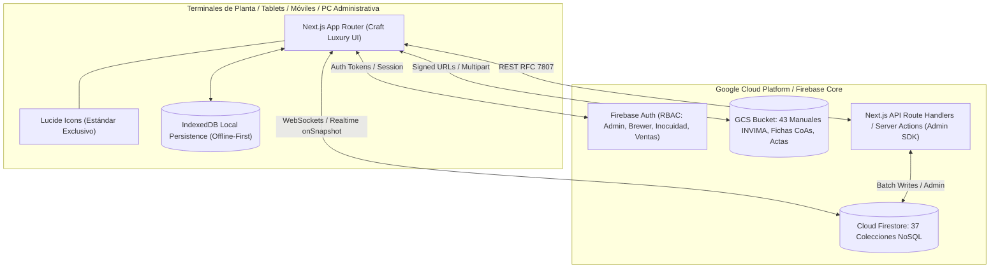
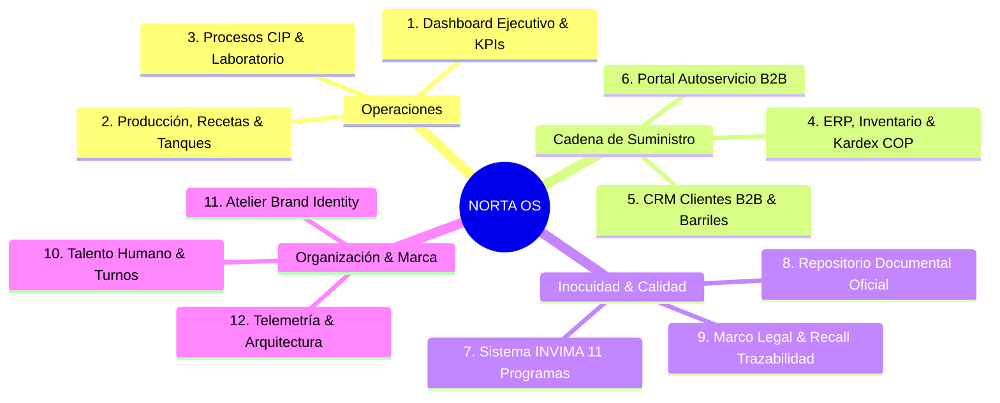
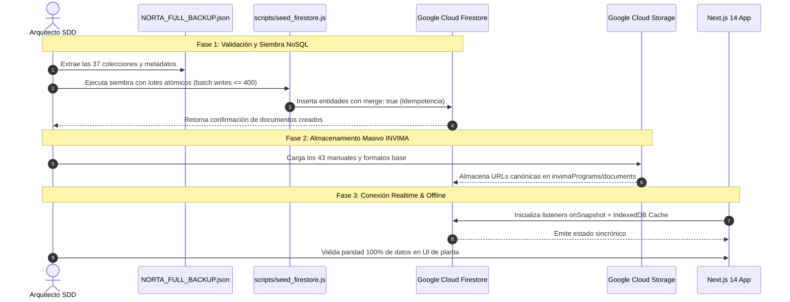

# 📐 ESPECIFICACIÓN TÉCNICA FORMAL (SDD) - ARQUITECTURA INTEGRAL Y RESOLUCIÓN DE DEUDA TÉCNICA
# Proyecto: Cervecería NORTA OS (Brewery Enterprise Suite 5.0 -> Target Cloud Suite 6.0)
# Versión del Documento: 3.1.0 (Enterprise Full Spectrum SSOT + Lean Manufacturing & BPM Evaluation)
# Fecha de Emisión: 2026-09-29
# Autoridad: Spec-Driven Development (SDD) Lead Architect & Cloud Principal Engineer

---

## 1. Declaración de Arquitectura y Alcance (System Scope)

### 1.1. Topología Actual (As-Is - Monolito Local V5.0)
- **Runtime:** SPA monolítica montada sobre React 18, empaquetada en un único archivo de alto acoplamiento ([`src/components/NextBreweryApp.js`](file:///g:/Mi%20unidad/Proyectos%20Antigravity%202026/cerveceria-norta/src/components/NextBreweryApp.js) de 278 KB).
- **Servidor Web Local:** Python Threading Server ([`servidor.py`](file:///g:/Mi%20unidad/Proyectos%20Antigravity%202026/cerveceria-norta/servidor.py)) despachando estáticos en puerto 3000 con scripts `.bat` auxiliares.
- **Capa de Persistencia:** Almacenamiento local volátil vía `localStorage` bajo claves `CERVECERIA_NORTA_DATA_V17` y `CERVECERIA_NORTA_BACKUP_V17`.
- **Riesgos Operativos:** Límite técnico de 5.0 MB de almacenamiento en navegador, monousuario (no colaborativo en tiempo real entre operarios de planta, maestro cervecero y gerencia), riesgo latente de pérdida de datos por limpieza de caché o formateo de terminal de planta.

### 1.2. Topología Objetivo (Target Architecture - Cloud Enterprise Suite 6.0)
- **Framework & Runtime Unificado:** **Next.js 14+ (App Router)** con TypeScript, segmentado en Server Components (RSC) para despacho seguro y Client Components para componentes interactivos de planta.
- **Base de Datos NoSQL Distribuida:** **Google Cloud Firestore (Firebase)** con persistencia offline local activada (`enableMultiTabIndexedDbPersistence` sobre IndexedDB) y suscripciones en tiempo real (`onSnapshot`) para que las tablets de cocción y fermentación sigan operando sin internet.
- **Repositorio de Documentos & Evidencias:** **Google Cloud Storage (Firebase Storage Bucket: `gs://cerveceria-norta.firebasestorage.app`)** para la custodia de los 43 manuales oficiales INVIMA, fotos de lotes y reportes Word/Excel.
- **Autenticación & Control de Acceso:** **Firebase Authentication (RBAC)** con 4 roles: Maestro Cervecero, Auxiliar de Planta, Encargado de Inocuidad/INVIMA y Gerencia.
- **Diseño & UI/UX:** Preservación al 100% de la identidad de marca NORTA (temas Claro Apergaminado y Oscuro Craft Luxury, tipografías Cinzel/Lato/JetBrains Mono), Tailwind CSS y cumplimiento estricto de **Lucide Icons** (prohibición de emojis o librerías de iconos externas).



---

## 2. Catálogo Funcional de Módulos del Sistema (12 Dominios de Negocio)

El sistema NORTA OS se estructura formalmente en 12 módulos funcionales que articulan todo el ecosistema productivo y normativo:



1. **Dashboard Ejecutivo & KPIs:** Concentrador de telemetría de planta en tiempo real: volumen mensual producido, tasa de ocupación de fermentadores, alertas automáticas de inventario bajo stock de seguridad y accesos directos de cocción.
2. **Producción, Recetas Maestras & Fermentación:** 
   - Control de lotes (`batches`) en ciclo cerrado de 6 etapas: *Maceración $\rightarrow$ Hervor $\rightarrow$ Fermentación $\rightarrow$ Maduración $\rightarrow$ Envasado $\rightarrow$ Finalizado*.
   - Gráfico SVG de cinética de fermentación (`FermentationSvgChart`) con curvas de atenuación de levadura (densidad observada vs OG vs FG).
   - Recetas de autor (`recipes`): Fórmulas balanceadas con malt bill, hop bill, tiempos de adición, OG, FG, ABV, IBU y SRM.
   - Tanques (`tanks`): Telemetría en tiempo real (temperatura en °C, presión en PSI, estatus CIP y lote asignado).
3. **Procesos, CIP & Laboratorio:** 
   - Bitácoras de sanitización CIP (`cipLogs`): soda cáustica, ácido peracético, temperatura, concentración y hisopado ATP (RLU).
   - Ensayos fisicoquímicos (`qualityTests`): densidad, pH, oxígeno disuelto (ppb), turbidez (NTU), diacetilo y cata sensorial.
4. **ERP, Inventarios & Kardex en COP:**
   - Materias primas (`rawInventory` - 32 insumos): maltas, lúpulos, levaduras, químicos y empaques con costeo unitario en COP.
   - Producto terminado (`finishedGoods` - 6 referencias): botellas y barriles con precios mayoristas y márgenes.
   - Kardex y movimientos (`inventoryMovements`): entradas, mermas de cocción y salidas a entrega.
   - Maquinaria y equipos (`machineryAndEquipment` - 9 activos): depreciación, valor de adquisición y vida útil.
5. **Comercial, CRM & Tracking de Barriles:**
   - Directorio de clientes B2B (`clients`): bares, pubs y restaurantes con líneas de crédito y cupos de barriles.
   - Órdenes de venta (`salesOrders`): líneas de pedido, total en COP/USD, estado de despacho y recaudo.
   - Parque de barriles / Keg Tracking (`kegs`): trazabilidad de números de serie, días en posesión de clientes y alertas de retardo.
6. **Portal Autoservicio Clientes B2B:** Vista exterior para locales comerciales con catálogo actualizado de estilos disponibles, selección de presentaciones (cajas o barriles) y registro directo de pedido.
7. **Sistema INVIMA - Buenas Prácticas de Manufactura (11 Programas Oficiales):** Digitalización de los 11 programas normativos de inocuidad según Resolución 2674/2013 y Decreto 2115/2007.
8. **Repositorio Documental:** Custodia digital de fichas técnicas, actas de visita sanitaria, certificados de análisis (CoAs) y conceptos.
9. **Marco Legal & Protocolo Recall:** Compilador de normatividad sanitaria nacional y motor de trazabilidad inversa para simulacros y retiros de producto en mercado por número de lote.
10. **Talento Humano & Turnos:** Registro de personal (`employees`), certificaciones de manipulación de alimentos y programación de turnos de planta (`shifts`).
11. **Atelier Brand Identity:** Manifiesto de marca, decálogo de pureza artesanal, guía de estilos y catálogo de empaques.
12. **Telemetría & Auditoría:** Búfer forense de transacciones (`AuditLogger`), salud de persistencia y benchmarking de software.

---

## 3. Modelo de Datos Target en Cloud Firestore (37 Colecciones NoSQL)

Todas las estructuras de datos han sido normalizadas para residir en Cloud Firestore con tipado estricto en TypeScript:

### 3.1. Dominio Producción y Brewhouse
```typescript
// /recipes/{recipeId}
export interface Recipe {
  id: string;                         // "rec-cumbre-golden"
  name: string;                       // "Cumbre Dorada"
  style: string;                      // "Golden Ale"
  targetVolumeL: number;              // 1000
  og: number;                         // 1.048
  fg: number;                         // 1.009
  abv: number;                        // 5.1
  ibu: number;                        // 22
  srmColor: number;                   // 4.5
  mashTemp: number;                   // 65.5
  boilTimeMin: number;                // 60
  brandPillar: string;
  liquidColor: string;
  image: string;
  glassware: string;
  servingTemp: string;
  pairing: string;
  intensity: string;
  sensoryTags: string[];
  grains: Array<{ name: string; amountKg: number; pct: number }>;
  hops: Array<{ name: string; amountGrams: number; timeMin: number; use: string }>;
  yeast: { strain: string; form: string; amountGrams: number };
  essence: string;
  sensoryDescription: string;
}

// /batches/{batchId}
export interface Batch {
  id: string;                         // "BATCH-2026-001"
  recipeName: string;
  style: string;
  tankId: string;
  volumeLiters: number;
  brewDate: string;                   // ISO Date
  targetPackDate: string;
  stage: "Maceración" | "Hervor" | "Fermentación" | "Maduración" | "Envasado" | "Finalizado";
  stageProgress: number;              // 0 - 100
  originalGravity: number;
  currentGravity: number;
  finalGravityTarget: number;
  currentTemp: number;
  targetTemp: number;
  abvCalculated: number;
  abvTarget: number;
  ibu: number;
  brewer: string;
  status: "Activo" | "En Pausa" | "Cuarentena" | "Completado";
  dryHopStatus: string;
  notes: string;
  cogsCostPerLiter: number;
  fermentationLogs: Array<{
    day: number;
    date: string;
    gravity: number;
    temp: number;
    pressureBar?: number;
    ph?: number;
  }>;
  maltsUsed: Array<{ name: string; lot: string; amountKg: number }>;
  hopsUsed: Array<{ name: string; lot: string; amountGrams: number }>;
  yeastUsed: { strain: string; lot: string; pitchRate: string };
}

// /tanks/{tankId}
export interface Tank {
  id: string;                         // "TK-01"
  name: string;                       // "Fermentador F1"
  type: "Fermentador" | "Madurador" | "BBT" | "Macerador";
  capacityL: number;
  currentL: number;
  currentBatchId: string | null;
  beerName: string;
  status: "Disponible" | "Ocupado" | "Limpio" | "CIP_Pendiente" | "Mantenimiento";
  tempC: number;
  pressureBar: number;
  daysInTank: number;
  glycolValve: "AUTO" | "OPEN" | "CLOSED";
  lastCipDate: string;
}
```

### 3.2. Dominio ERP, Inventarios & Finanzas (COP)
```typescript
// /rawInventory/{itemId}
export interface RawInventoryItem {
  id: string;                         // "RAW-MAL-001"
  name: string;                       // "Malta Pale Ale 2-Row"
  category: "Maltas" | "Lúpulos" | "Levaduras" | "Químicos" | "Empaques";
  stockInitial: number;
  entries: number;
  entryDate: string;
  expiryDate: string;
  entryUnitPrice: number;             // COP
  exits: number;
  stock: number;
  unit: "Kg" | "Gramos" | "Litros" | "Unidades";
  minStock: number;
  costPerUnit: number;                // COP
  supplier: string;
  status: "NORMAL" | "LOW_STOCK" | "EXPIRED";
}

// /finishedGoods/{goodId}
export interface FinishedGood {
  id: string;                         // "FG-CUM-B330"
  name: string;                       // "Cumbre Golden Ale Botella 330ml"
  style: string;
  packaging: "Botella 330ml" | "Botella 750ml" | "Barril 30L" | "Barril 50L";
  brewDate: string;
  stockUnits: number;
  litersPerUnit: number;
  cogsCost: number;                   // Costo de producción en COP
  wholesalePrice: number;             // Precio B2B en COP
  marginPct: number;
  marginAbs: number;
}

// /inventoryMovements/{movId}
export interface InventoryMovement {
  id: string;                         // "MOV-2026-089"
  date: string;
  type: "ENTRADA" | "SALIDA" | "MERMA" | "TRANSFERENCIA";
  category: "Materias Primas" | "Producto Terminado";
  itemId: string;
  itemName: string;
  quantity: number;
  unit: string;
  reason: string;
  notes: string;
  responsible: string;
  transformationLinkedId?: string;    // ID del lote asociado
}

// /machineryAndEquipment/{equipId}
export interface MachineryEquipment {
  id: string;
  name: string;
  category: "Cocción" | "Frío" | "Envasado" | "Servicios";
  purchaseDate: string;
  acquisitionCost: number;            // COP
  usefulLifeYears: number;
  currentStatus: "Operativo" | "En Mantenimiento" | "Fuera de Servicio";
  depreciationAccumulated: number;
}
```

### 3.3. Dominio Comercial, CRM & Parque de Barriles
```typescript
// /clients/{clientId}
export interface Client {
  id: string;                         // "CLI-001"
  name: string;                       // "The Craft House Bar"
  type: "Bar" | "Restaurante" | "Tienda Especializada" | "Distribuidor";
  contactName: string;
  phone: string;
  email: string;
  city: string;
  creditLimit: number;                // COP / USD
  kegsInPossession: number;
  totalPurchasesUSD: number;
  status: "ACTIVO" | "EN_MORA" | "INACTIVO";
  pinCode?: string;                   // Acceso al Portal B2B
}

// /salesOrders/{orderId}
export interface SalesOrder {
  id: string;                         // "ORD-2026-045"
  clientName: string;
  date: string;
  items: Array<{
    productId: string;
    productName: string;
    quantity: number;
    unitPrice: number;
    total: number;
  }>;
  totalAmountUSD: number;
  status: "Cotización" | "Aprobada" | "En Preparación" | "Despachada" | "Entregada";
  paymentStatus: "Pendiente" | "Pagado" | "Crédito 30D";
  deliveryDate: string;
}

// /kegs/{serial}
export interface Keg {
  serial: string;                     // "NOR-K50-014"
  capacityL: number;                  // 20 | 30 | 50
  style: string;
  client: string | null;
  sentDate: string | null;
  daysOut: number;
  alert: "OK" | "WARNING" | "CRITICAL_OVERDUE";
}
```

### 3.4. Dominio Calidad, Procesos & Laboratorio
```typescript
// /cipLogs/{cipId}
export interface CipLog {
  id: string;                         // "CIP-2026-012"
  date: string;
  equipment: string;                  // "Fermentador F1"
  operator: string;
  cycleType: "Cáustico" | "Ácido" | "Sanitizante" | "Completo 3 Pasos";
  causticTempC: number;
  causticConcentrationPct: number;
  peraceticConcentrationPpm: number;
  rinseFinalPh: number;
  swabAdenosineTriphosphateRlu: number; // ATP < 30 RLU (Superficie Estéril)
  status: "CONFORME" | "NO_CONFORME";
  supervisor: string;
}

// /qualityTests/{testId}
export interface QualityTest {
  id: string;                         // "LAB-2026-004"
  batchId: string;
  date: string;
  style: string;
  tank: string;
  ph: number;
  dissolvedOxygenPpb: number;         // < 50 ppb en maduración
  carbonationVolCo2: number;
  turbidityNtu: number;
  diacetylSensoryScore: number;       // 1 - 5 (Ausente/Presente)
  sensoryScore100: number;            // 0 - 100
  analyst: string;
  overallVerdict: "APROBADO_ENVASADO" | "EN_OBSERVACION" | "RECHAZADO";
}
```

### 3.5. Dominio Sistema Sanitario INVIMA (11 Colecciones Operativas)
```typescript
// 1. /invimaWaterLogs/{logId} (Formato FO-AG-002)
export interface WaterControlLog {
  id: string;
  date: string;
  time: string;
  location: string;
  chlorineMgL: number;                // 0.3 - 2.0 mg/L (Dec. 2115/2007)
  ph: number;                         // 6.5 - 9.0
  complies: "SI" | "NO";
  verifiedBy: string;
  notes: string;
}

// 2. /invimaStorageLogs/{logId} (Formato FO-ALM-001)
export interface StorageIngressLog {
  id: string;
  date: string;
  product: string;
  batchLot: string;
  quantity: string;
  supplier: string;
  expiryDate: string;
  notes: string;
  responsible: string;
}

// 3. /phMeterLogs/{logId}
export interface PhMeterLog {
  id: string;
  date: string;
  buffer4Reading: number;
  buffer4Temp: number;
  buffer4Error: number;
  buffer7Reading: number;
  buffer7Temp: number;
  buffer7Error: number;
  status: "CALIBRADO" | "DESVIADO";
  verifiedBy: string;
}

// 4. /calibrationSchedule/{id}
export interface CalibrationScheduleItem {
  id: string;
  equipment: string;
  frequency: string;
  lastCal: string;
  nextCal: string;
  lab: string;
  cert: string;
}

// 5. /trainingSchedule/{id} & /trainingAttendance/{id}
export interface TrainingAttendanceLog {
  id: string;
  date: string;
  topic: string;
  employee: string;
  nationalId: string;
  role: string;
  score: number;
  status: "APROBADO" | "REPROBADO";
}

// 6. /pestControlLogs/{id}
export interface PestControlLog {
  id: string;
  date: string;
  station: string;
  baitStatus: "INTACTO" | "CONSUMIDO" | "DETERIORADO";
  pestsObserved: string;
  barriersStatus: "CONFORME" | "REQUIERE_AJUSTE";
  correctiveAction: string;
  technician: string;
}

// 7. /cleaningSanitationLogs/{id}
export interface CleaningSanitationLog {
  id: string;
  date: string;
  area: string;
  frequency: "Diario" | "Semanal" | "Mensual";
  chemical: string;
  concentration: string;
  status: "CONFORME" | "NO_CONFORME";
  verifiedBy: string;
}

// 8. /wasteManagementLogs/{id}
export interface WasteManagementLog {
  id: string;
  date: string;
  wasteType: "Bagazo" | "Levadura_Residual" | "Cartón" | "Vidrio" | "Efluente";
  quantityKg: number;
  manager: string;                    // Gestor o productor agropecuario
  status: "DISPUESTO" | "APROVECHADO";
  verifiedBy: string;
}

// 9. /maintenanceLogs/{id}
export interface MaintenanceLog {
  id: string;
  date: string;
  equipment: string;
  type: "PREVENTIVO" | "CORRECTIVO";
  description: string;
  parts: string;
  technician: string;
  status: "COMPLETADO" | "PENDIENTE_REPUESTO";
}

// 10. /samplingLogs/{id} & /coldRoomLogs/{id}
export interface ColdRoomLog {
  id: string;
  date: string;
  time: string;
  tempColdRoom1: number;              // 0 - 4 °C
  tempColdRoom2: number;
  status: "EN_RANGO" | "ALERTA_TERMICA";
  verifiedBy: string;
}

// 11. /suppliersList/{id} & /retainedSamplesLogs/{id}
export interface RetainedSampleLog {
  id: string;
  date: string;
  beerName: string;
  batchLot: string;
  presentation: string;
  units: number;
  shelfLocation: string;
  responsible: string;
  notes: string;
}
```

### 3.6. Dominio Talento Humano y Singletons Corporativos
```typescript
// /employees/{id} & /shifts/{day}
export interface Employee {
  id: string;
  name: string;
  role: "Maestro Cervecero" | "Auxiliar de Planta" | "Encargado de Inocuidad" | "Gerente General";
  dept: "Producción" | "Calidad" | "Administración" | "Comercial";
  phone: string;
  email: string;
  joinDate: string;
  certStatus: "VIGENTE" | "POR_RENOVAR" | "VENCIDO";
}

// /config/info (Singleton)
export interface BreweryInfo {
  name: string;
  tagline: string;
  nit: string;
  location: string;
  capacityMonthlyLiters: number;
  generalManager: string;
  commercialManager: string;
  financialManager: string;
  productionManager: string;
  headBrewer: string;
  complianceOfficer: string;
}
```

---

## 4. Inventario Oficial de Documentos INVIMA y Mapeo a Cloud Storage

Los **43 archivos oficiales** del Sistema de Gestión de Calidad e Inocuidad ubicados físicamente en [`invima_docs/`](file:///g:/Mi%20unidad/Proyectos%20Antigravity%202026/cerveceria-norta/invima_docs) se mapean formalmente a la jerarquía de almacenamiento de **Google Cloud Storage**:

**Bucket Target:** `gs://cerveceria-norta.firebasestorage.app/invima/`

| ID Programa | Programa Oficial BPM | Archivo Local en Repositorio | Tipo | Tamaño | Destino en GCS |
| :--- | :--- | :--- | :--- | :--- | :--- |
| **PROG-01** | **Control de Calidad de Agua** | `3. Programa de Agua FURIA V01 - Norta.docx` | Manual | 5.09 MB | `invima/prog_01/manual_programa_agua_v1.docx` |
| | | `2. FO CONTROL DE AGUA POTABLE.docx` | Formato | 80 KB | `invima/prog_01/FO-AG-002_base.docx` |
| | | `INSTRUCTIVOS ANÁLISIS AGUA - Norta.xlsx` | Instructivo | 30 KB | `invima/prog_01/instructivo_analisis_agua.xlsx` |
| **PROG-02** | **Almacenamiento e Ingreso** | `PROGRAMA DE ALMACENAMIENTO - Norta.docx` | Manual | 3.75 MB | `invima/prog_02/manual_almacenamiento_v1.docx` |
| | | `FORMATO DE INGRESO DE PRODUCTOS - Norta.xlsx`| Formato | 100 KB | `invima/prog_02/FO-ALM-001_base.xlsx` |
| **PROG-03** | **Calibración de Instrumentos** | `PROGRAMA DE CALI BRACION .docx` | Manual | 3.25 MB | `invima/prog_03/manual_calibracion_v1.docx` |
| | | `6. Programa de Calibración FURIA V1.docx` | Anexo | 60 KB | `invima/prog_03/anexo_calibracion.docx` |
| | | `FORMATOS DE CALIBRACION.xlsx` | Formato | 170 KB | `invima/prog_03/formatos_calibracion.xlsx` |
| | | `CRONOGRAMA CALIBRACION .xlsx` | Cronograma | 90 KB | `invima/prog_03/cronograma_calibracion.xlsx` |
| | | `VERIFICACIÓN PHMETRO .xlsx` | Bitácora | 50 KB | `invima/prog_03/verificacion_phmetro.xlsx` |
| **PROG-04** | **Capacitación de Personal** | `7. Programa de capacitación  FURIA V1.docx` | Manual | 4.18 MB | `invima/prog_04/manual_capacitacion_v1.docx` |
| | | `CRONOGRAMA CAPACITACIONES  - Norta.xlsx` | Cronograma | 110 KB | `invima/prog_04/cronograma_capacitaciones.xlsx`|
| | | `ASISTENCIA CAPACITACIONES - Norta.xlsx` | Formato | 40 KB | `invima/prog_04/formato_asistencia.xlsx` |
| **PROG-05** | **Control Integral de Plagas** | `2. Prog. Control de plagas FURIA V01.docx` | Manual | 3.81 MB | `invima/prog_05/manual_plagas_v1.docx` |
| | | `4. FO CONTROL DE PLAGAS.docx` | Formato | 60 KB | `invima/prog_05/FO_control_plagas.docx` |
| | | `1. FO L&D.docx` | Formato | 60 KB | `invima/prog_05/FO_barreras_sanitarias.docx` |
| **PROG-06** | **Limpieza y Desinfección** | `1. Programa de LYD FURIA V01.docx` | Manual | 4.34 MB | `invima/prog_06/manual_limpieza_desinfeccion.docx`|
| | | `BPM-PR-01a25   PROCEDIMIENTOS...xlsx` | POES | 590 KB | `invima/prog_06/BPM_PR_01_25_POES.xlsx` |
| | | `1. FO L&D.docx` | Formato | 60 KB | `invima/prog_06/FO_limpieza_areas.docx` |
| | | `5. FO L&D PRODUCTO (2).docx` | Formato | 50 KB | `invima/prog_06/FO_limpieza_tanques.docx` |
| **PROG-07** | **Manejo de Residuos** | `4. Programa de Residuos Sólidos FURIA V01.docx`| Manual | 1.04 MB | `invima/prog_07/manual_residuos_v1.docx` |
| | | `3. FO MANEJO DE RESIDUOS SÓLIDOS.docx` | Formato | 50 KB | `invima/prog_07/FO_residuos_solidos.docx` |
| | | `FORMATOS RESIDUOS - Norta.xlsx` | Bitácora | 40 KB | `invima/prog_07/bitacora_residuos.xlsx` |
| **PROG-08** | **Mantenimiento Maquinaria** | `5. Programa de Mantenimiento FURIA V1.docx` | Manual | 4.33 MB | `invima/prog_08/manual_mantenimiento_v1.docx` |
| | | `CRONOGRAMA MANTENIMIENTO - Norta.xlsx` | Cronograma | 180 KB | `invima/prog_08/cronograma_mantenimiento.xlsx`|
| | | `10. FO VERIFICACION EQUIPOS.docx` | Formato | 40 KB | `invima/prog_08/FO_verificacion_equipos.docx` |
| | | `11. FO RGS MANTENIMIENTO.docx` | Formato | 50 KB | `invima/prog_08/FO_registro_mantenimiento.docx`|
| | | `9. FO MVT CUARTOS FRIOS.docx` | Formato | 50 KB | `invima/prog_08/FO_mantenimiento_frio.docx` |
| **PROG-09** | **Muestreo & Laboratorio** | `PROGRAMA DE MUESTREO  - Norta.docx` | Manual | 3.94 MB | `invima/prog_09/manual_muestreo_v1.docx` |
| | | `PROCEDIMIENTO INSPECCION DE MP   - Norta.docx`| Procedimiento| 3.94 MB | `invima/prog_09/procedimiento_inspeccion_mp.docx`|
| | | `CRONOGRAMA DE MUESTREO LAB...xlsx` | Cronograma | 40 KB | `invima/prog_09/cronograma_muestreo_ext.xlsx` |
| | | `8. FO RECEPCION MATERIAS PRIMAS.docx` | Formato | 50 KB | `invima/prog_09/FO_muestreo_recepcion.docx` |
| | | `7. FO CUARTOS FRIOS.xlsx` | Bitácora | 60 KB | `invima/prog_09/control_cuartos_frios.xlsx` |
| **PROG-10** | **Control de Proveedores** | `8. Programa Control de Proveedores...docx` | Manual | 3.55 MB | `invima/prog_10/manual_proveedores_v1.docx` |
| | | `LISTADO DE PROVEEDORES.xlsx` | Matriz | 40 KB | `invima/prog_10/matriz_proveedores_homologados.xlsx`|
| **PROG-11** | **Trazabilidad & Recall** | `PROGRAMA DE TRAZABILIDAD - Norta.docx` | Manual | 3.86 MB | `invima/prog_11/manual_trazabilidad_v1.docx` |
| | | `6. FO CONTROL PRODUCCION.docx` | Formato | 70 KB | `invima/prog_11/FO_control_produccion.docx` |
| | | `REGISTRO CONTRAMUESTRAS.xlsx` | Bitácora | 40 KB | `invima/prog_11/registro_contramuestras.xlsx` |
| | | `FORMATO INSPECCIÓN VEHÍCULO.xlsx` | Formato | 40 KB | `invima/prog_11/inspeccion_vehiculo.xlsx` |

---

## 5. Evaluación de Deuda Técnica bajo Lean Manufacturing & BPM (DOWNTIME & Poka-Yoke)

La deuda técnica del software no es un problema abstracto de ingeniería: en una cervecería artesanal de precisión, constituye una fuente directa de **Muda** (desperdicio), **Muri** (sobrecarga operativa del personal) y **Mura** (variabilidad en la calidad e inocuidad del producto).

### 5.1. Matriz DOWNTIME: Desperdicios Operacionales de Planta vs. Deuda de Software
| Sigla | Desperdicio Lean | Manifestación Operativa en Planta Cervecera NORTA | Deuda Técnica de Software | Severidad |
| :---: | :--- | :--- | :--- | :---: |
| **D** | **Defects (Defectos)** | Riesgo de pérdida total de bitácoras sanitarias por borrado de caché del navegador (`localStorage`). Errores de cálculo cinético desincronizados. | **DT-01** (Falta de persistencia Cloud Firestore) | 🔴 **Crítica** |
| **O** | **Overproduction (Sobreproducción)** | Generación de copias redundantes en hojas de cálculo locales desarticuladas del repositorio oficial. | **DT-02** / **DT-08** (Archivos locales huérfanos) | 🟡 Media |
| **W** | **Waiting (Esperas)** | El maestro cervecero debe esperar el cambio de turno o el envío manual de archivos para conocer la atenuación de un lote. | **DT-01** / **DT-03** (Monolito local monousuario) | 🔴 **Alta** |
| **N** | **Non-utilized Talent (Talento)** | Profesionales calificados (Ingeniero de Calidad / Maestro Cervecero) perdiendo 45 min/día transcribiendo manualmente datos a formatos Word. | **DT-08** (Falta de generación dinámica de actas) | 🔴 **Alta** |
| **T** | **Transportation (Transporte)** | Traspaso manual de información mediante memorias USB o correos electrónicos entre sala de cocción, laboratorio y gerencia. | **DT-02** (Falta de bucket central GCS) | 🟡 Media |
| **I** | **Inventory / WIP (WIP Oculto)** | Falta de visibilidad exacta de materias primas consumidas por lote en tiempo real, provocando quiebres imprevistos de stock o sobrecompras. | **DT-01** (Kardex no sincronizado en tiempo real) | 🔴 **Alta** |
| **M** | **Motion (Movimiento)** | Desplazamientos innecesarios del personal desde la zona húmeda de tanques hasta la computadora administrativa para consultar recetas o registrar densidades. | **DT-03** / **DT-12** (Falta de UX optimizada para tablets de planta) | 🟡 Media |
| **E** | **Extra Processing (Sobreproceso)** | Diligenciar la bitácora física en papel, transcribirla a Excel y luego validarla visualmente contra los rangos normativos. | **DT-07** / **DT-09** (Falta de Poka-Yoke sanitario automatizado) | 🔴 **Alta** |

### 5.2. Evaluación de Riesgo Sanitario & BPM (Res. 2674/2013 y Dec. 2115/2007)
1. **Integridad e Inalterabilidad de Registros Sanitarios (Art. 36 Res. 2674):**
   - *Riesgo Actual:* La persistencia en `localStorage` carece de cadena de custodia, auditoría de cambios y autenticación de autoría. Cualquier usuario puede alterar valores desde la consola del navegador, lo cual vulnera los requisitos legales del INVIMA.
   - *Solución SDD:* Base de datos transaccional Cloud Firestore protegida por reglas de seguridad y marcas de tiempo inmutables de servidor (`serverTimestamp`).
2. **Poka-Yoke Sanitario en Puntos Críticos de Control (PCC):**
   - *Riesgo Actual:* Si un operario registra un nivel de cloro residual no conforme (ej. $0.10\text{ mg/L}$ fuera del rango $0.3 - 2.0\text{ mg/L}$ del Dec. 2115/2007), el sistema actual solo renderiza una etiqueta en rojo en la pantalla local, pero no bloquea preventivamente el inicio de maceración ni genera alertas inmediatas a la Dirección Técnica.
   - *Solución SDD (DT-09):* Mecanismo Poka-Yoke digital que inhabilita la asignación de agua a lotes de cocción hasta que se asiente la acción correctiva.
3. **Trazabilidad Inversa y Retiro de Producto (Recall < 2 horas):**
   - *Riesgo Actual:* Al estar fragmentados los datos de materias primas, lotes y clientes en archivos aislados, un simulacro de recall hoy tomaría horas de consolidación manual.
   - *Solución SDD (DT-10):* Grafo relacional en Firestore que permite trazabilidad bidireccional instantánea: *Proveedor $\leftrightarrow$ Lote Insumo $\leftrightarrow$ Lote Cerveza $\leftrightarrow$ Tanque $\leftrightarrow$ Pedido B2B $\leftrightarrow$ Serial de Barril*.

### 5.3. Value Stream Mapping (VSM) y Eficiencia de Flujo
$$\text{Eficiencia del Flujo} = \frac{\text{Tiempo de Agregado de Valor}}{\text{Lead Time Total Transcurrido}} \times 100$$
- **Flujo As-Is (Con Deuda Técnica):** 5 minutos de valor real (toma de muestra y decisión) dentro de un ciclo de 30 minutos (búsqueda de archivos, transcripción manual, exportación a USB y esperas). **Eficiencia de Flujo: $\approx 16.6\%$**.
- **Flujo Target Suite 6.0 (Lean SDD):** Registro táctil inmediato en tablet de planta (2 min), validación Poka-Yoke automática y sincronización en tiempo real con la nube (1 min). **Eficiencia de Flujo: $> 85\%$**.

---

## 6. Matriz de Deuda Técnica & Requerimientos de Transición (DT-01 a DT-12)

| ID | Requerimiento Técnico | Especificación Ejecutable | Estado Actual | Plan de Acción Inmediato |
| :--- | :--- | :--- | :--- | :--- |
| **DT-01** | **Persistencia Cloud Firestore** | Conexión a 37 colecciones NoSQL con listeners en tiempo real (`onSnapshot`) y persistencia offline IndexedDB. | Configurado en `.env.local` y `firebase.js`. Script preparado. | Ejecutar `seed_firestore.js` y conmutar `DataRepository.js` a Firestore. |
| **DT-02** | **Almacenamiento Cloud Storage** | Subida y enlace seguro de los 43 manuales oficiales INVIMA y evidencias fotográficas con URLs firmadas. | Bucket configurado en Firebase. | Implementar servicio `storage.ts` y script de migración masiva de `invima_docs/`. |
| **DT-03** | **Desacoplamiento Modular Next.js** | Fragmentar el monolito `NextBreweryApp.js` (278 KB) en subrutas atómicas del App Router (`/produccion`, `/inventario`, `/invima`, `/crm`). | Monolito montado vía dynamic import en `app/page.js`. | Crear subcarpetas en `app/` con layouts compartidos y reuso de hooks. |
| **DT-04** | **Garantía Zero Data Loss** | Preservación del 100% de registros históricos de respaldo mediante verificación de hash de siembra. | Backup universal en `NORTA_FULL_BACKUP_2026-09-23.json`. | Validar conteo de documentos en Firestore post-siembra. |
| **DT-05** | **Estandarización de Iconografía** | Regla de cero emojis y uso exclusivo de la librería `lucide-react`. | Paquete instalado en `package.json`. | Limpieza de caracteres emoji residuales en botones de interfaz. |
| **DT-06** | **Seguridad & RBAC Firebase Auth** | Autenticación con roles (*Maestro Cervecero, Auxiliar, Calidad/INVIMA, Gerencia*). | Pendiente de implementación. | Crear `src/lib/auth.ts` y Middleware de Next.js para protección de rutas. |
| **DT-07** | **Contrato OpenAPI 3.1 & Testing** | Especificación formal de todas las rutas REST con manejo de errores RFC 7807 (`application/problem+json`). | OpenAPI expandido a v6.0.0. | Correr validación con Spectral y Schemathesis. |
| **DT-08** | **Generación Dinámica de Actas** | Generación de reportes DOCX y XLSX al vuelo para `FO-AG-002` y `FO-ALM-001` consumiendo Firestore. | Scripts prototipo en Python. | Migrar lógica a Route Handlers nativos TypeScript en `/api/export/...`. |
| **DT-09** | **Poka-Yoke Sanitario en PCC** | Bloqueo preventivo en interfaz y Firestore si mediciones de agua (`FO-AG-002`) o almacenamiento (`FO-ALM-001`) violan Decreto 2115 o Res. 2674. | Solo alerta visual en cliente. | Implementar guards en mutaciones de lote y disparo de alerta de no conformidad. |
| **DT-10** | **Motor de Recall Automatizado (< 2h)** | Consulta indexada bidireccional que reconstruye en un clic la cadena de custodia completa de cualquier lote en mercado. | Búsqueda simple en array local. | Crear endpoint `/api/v1/traceability/recall/{batchCode}` con trazabilidad inversa en grafo. |
| **DT-11** | **Depuración Kaizen 5S del Repositorio** | Eliminación de archivos obsoletos (`servidor.py`, copias `.bak`, scripts de parcheo manuales `.py`, archivos temporales `~$`). | Múltiples artefactos heredados en raíz. | Ejecutar ciclo *Seiri* (Clasificar) y *Seiton* (Ordenar) para dejar el repositorio limpio. |
| **DT-12** | **UX de Planta & Eficiencia de Flujo (VSM)** | Interfaz adaptativa de alto contraste táctil para tablets en sala de cocción con captura rápida de densidades y temperaturas. | UI de escritorio densa. | Diseñar modo *Brewery Floor Quick Mode* con botones táctiles de 48px y soporte offline. |

---

## 7. Arquitectura de Software Next.js 14 (App Router Modular)

Estructura de árbol de directorios que reemplaza la arquitectura monolítica:

```text
cerveceria-norta/
├── app/
│   ├── layout.tsx                   # ThemeProvider, Font Cinzel/Lato, Firebase AuthContext
│   ├── page.tsx                     # Dashboard Ejecutivo con KPIs en vivo
│   ├── produccion/
│   │   ├── layout.tsx               # Sub-navegador de producción
│   │   ├── lotes/
│   │   │   ├── page.tsx             # Grilla de lotes activos y finalizados
│   │   │   └── [id]/page.tsx        # Detalle cinético del lote (Curva SVG, densidades)
│   │   ├── recetas/page.tsx         # Catálogo de recetas y formulación
│   │   └── tanques/page.tsx         # Monitoreo de fermentadores y estados CIP
│   ├── inventario/
│   │   ├── materias-primas/page.tsx # Kardex COP de granos, lúpulos y empaques
│   │   ├── producto-terminado/page.tsx
│   │   └── movimientos/page.tsx     # Bitácora de entradas, salidas y mermas
│   ├── crm/
│   │   ├── clientes/page.tsx        # Directorio comercial B2B
│   │   ├── ordenes/page.tsx         # Liquidación de pedidos y despachos
│   │   └── barriles/page.tsx        # Trazabilidad de parque de barriles (Keg Tracking)
│   ├── b2b-portal/page.tsx          # Portal externo de autoservicio para clientes
│   ├── calidad/
│   │   ├── cip/page.tsx             # Bitácoras de sanitización de líneas y tanques
│   │   └── laboratorio/page.tsx     # Ensayos fisicoquímicos y organolépticos
│   ├── invima/
│   │   ├── page.tsx                 # Selector de los 11 Programas de Inocuidad
│   │   ├── agua-potable/page.tsx    # Bitácora interactiva FO-AG-002 (Dec. 2115/2007)
│   │   ├── almacenamiento/page.tsx  # Bitácora FO-ALM-001 y control de materias primas
│   │   └── [programaId]/page.tsx    # Vistas dinámicas por programa sanitario
│   ├── rrhh/page.tsx                # Colaboradores, certificaciones y turnos
│   ├── marca/page.tsx               # Atelier Brand Identity, manifiesto y catálogo
│   └── api/
│       ├── v1/
│       │   ├── recipes/route.ts
│       │   ├── batches/route.ts
│       │   ├── tanks/route.ts
│       │   ├── inventory/route.ts
│       │   ├── crm/route.ts
│       │   └── invima/[progId]/route.ts
│       └── export/
│           ├── fo-ag-002/route.ts   # Generación de DOCX oficial de agua
│           └── fo-alm-001/route.ts  # Generación de XLSX de ingreso
├── components/
│   ├── ui/                          # Button, Modal, Card, Input con estética Luxury NORTA
│   ├── charts/                      # FermentationSvgChart desacoplado
│   └── icons/                       # Re-exportaciones estrictas de lucide-react
├── lib/
│   ├── firebase/
│   │   ├── clientApp.ts             # Firestore con IndexedDB Persistence
│   │   ├── adminApp.ts              # Firebase Admin SDK para Route Handlers
│   │   ├── firestoreServices.ts     # CRUD tipado para las 37 colecciones
│   │   └── storageServices.ts       # Subida de actas y fotos a GCS
│   └── utils/
│       └── beerCalculations.ts      # Cálculo ABV, atenuación, dilución y color SRM
├── specs/
│   ├── SDD_ESTADO_ACTUAL_NORTA_OS.md # Este documento SSOT
│   └── norta-enterprise-api.yaml    # Contrato OpenAPI 3.1.0 formal
└── types/
    └── brewery.ts                   # Interfaces TypeScript unificadas
```

---

## 8. Procedimiento de Migración & Verificación Zero Data Loss



---

## 9. Protocolo de Pruebas de Contrato (Contract Testing) & OpenAPI 3.1

1. **Linting de Contrato:** Todas las definiciones OpenAPI deben pasar la validación estricta de **Spectral** bajo reglas de nomenclatura `camelCase` y respuestas de error RFC 7807 (`ProblemDetails`).
2. **Validación Automática con Schemathesis:** Ejecución de pruebas basadas en propiedades contra los Route Handlers de Next.js para certificar que ningún payload responda con esquemas no definidos en la especificación.
3. **Control de Breaking Changes:** Cualquier modificación a los tipos o contratos requerirá la emisión de una versión menor (Minor) o mayor (Major) en el encabezado de este SDD antes de tocar una sola línea de código en los controladores.
